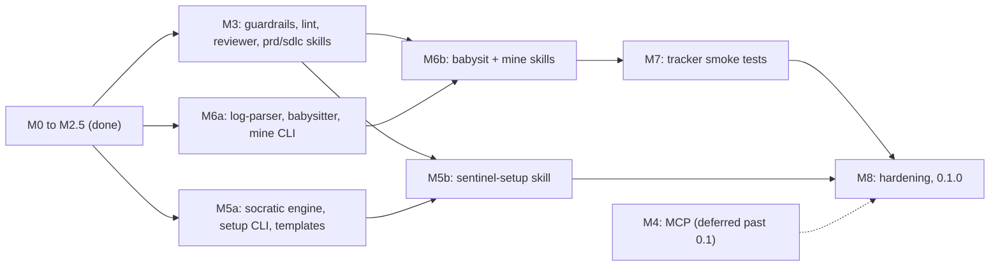
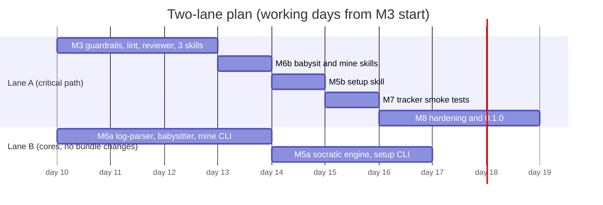

# sentinel — Implementation Plan

> **Status:** v4 — v2 decisions locked after the design-grilling session (2026-11-02); issue trackers revised on 2026-11-04 to use the host agent's own tooling (ADR-0005); distribution revised on 2026-11-09 from an npm package to a plugin marketplace (ADR-0006). See §11 for the full decision log.
> Source: _Refined Requirements Specification: `sentinel`_ (PDLC/SDLC platform spec + master generator prompt).
> Repo at planning time: empty (`README.md` = `# sentinel`), remote `github.com/robert-nagy/sentinel`, branch `main`.

---

## 1. What we're building

`sentinel` is a **public, MIT-licensed, cross-platform (Linux/macOS/Windows) plugin for AI coding tools**, distributed from a **plugin marketplace in this repository** (ADR-0006) and never published to npm. It governs the product and software lifecycle in a repo, from bootstrapping through PRDs to issue → PR, inside Claude Code, VS Code / Copilot, Codex or Cursor.

Three layers, kept strictly separate:

| Layer                     | What it is                                                                                                                                                                                                                                                 | Runs where                                                   |
| ------------------------- | ---------------------------------------------------------------------------------------------------------------------------------------------------------------------------------------------------------------------------------------------------------- | ------------------------------------------------------------ |
| **A. Deterministic core** | TypeScript library + CLI: config, branch naming, stack detection, git worktrees, tracker resolution + local tracker, code host (PRs/CI), PRD structural validation, CI log parsing, state, file generation. Same input → same output; fully unit-testable. | the bundled `sentinel` CLI                                   |
| **B. Skills**             | The workflow intelligence, written as **Agent Skills (`SKILL.md`)**: `sentinel-setup`, `sentinel-prd`, `sentinel-sdlc`, `sentinel-sdlc-auto`, `sentinel-babysit`, `sentinel-mine`, plus one sub-agent, `sentinel-reviewer`.                                | The host agent (Claude Code, VS Code/Copilot, Codex, Cursor) |
| **C. Packaging**          | The repo is a plugin marketplace: one hand-written catalog and manifest (Claude Code format), thin generated manifests for the other tools, and the bundled CLI copied into every skill. No installer.                                                     | the host tool's plugin install                               |

### Core principle: sentinel never calls an LLM _(decision Q1)_

The host agent does all the reasoning. Sentinel supplies (1) skills that tell the agent what to do and (2) deterministic tools the agent calls through the CLI or MCP. The same split applies to connections: **sentinel does not duplicate tracker clients the agent already has** (MCP servers, authenticated CLIs); it records which tracker to use and decides that deterministically (§4, ADR-0005). **Rules that matter are enforced in code, not prose**: the PRD threshold, per-dimension floor and iteration cap; babysitter attempt limits; branch naming; never committing to the default branch. No API keys, no model lock-in. Headless use is still possible later by running a host agent headless (e.g. `claude -p "/sentinel-babysit 42"` in CI); sentinel itself never owns a model.

---

## 2. Spec deviations (agreed)

| #   | Spec                                                                                                      | Plan                                                                                                                                                                                            |
| --- | --------------------------------------------------------------------------------------------------------- | ----------------------------------------------------------------------------------------------------------------------------------------------------------------------------------------------- |
| 1   | `npm i -g sentinel`                                                                                       | **Not on npm.** Installed as a plugin from the marketplace in this repo; the CLI ships inside each skill (ADR-0006).                                                                            |
| 2   | `.js` files                                                                                               | **TypeScript**, built with `tsup` to ESM JS. Same module names as the spec, with a `.ts` extension.                                                                                             |
| 3   | Score = mean of 5 dimensions ≥ 85                                                                         | **Mean ≥ 85 and every dimension ≥ 70** (`dimensionFloor`, configurable).                                                                                                                        |
| 4   | "up to 3 refinements" / "iteration > 3"                                                                   | Evaluation 0 = first draft; refinements 1–3; **max 4 evaluations**; escalate if refinement 3 still fails.                                                                                       |
| 5   | "push fixes until green"                                                                                  | Capped: `maxAttempts` (default 5), stop when the same failure signature repeats twice, one flaky re-run before patching, never force-push, never push to the default branch.                    |
| 6   | Auto-install test frameworks                                                                              | Propose → confirm. `--yes` for non-interactive runs.                                                                                                                                            |
| 7   | Per-tool commands/rules (`.claude/commands`, `.cursor/rules/*.mdc` for workflows, `.opencode/agent.json`) | Workflows are **skills** shipped in one plugin and installed from the marketplace (ADR-0006). Per-tool files shrink to generated manifests, a Cursor guardrail rule and the reviewer sub-agent. |
| 8   | Slash commands `/prd`, `/sdlc-worktree`, `/setup-repo`                                                    | Skills named **`/sentinel-setup`, `/sentinel-prd`, `/sentinel-sdlc`, `/sentinel-sdlc-auto`, `/sentinel-babysit`, `/sentinel-mine`**.                                                            |
| 9   | One "issue provider" concept                                                                              | Split into **`issueProvider`** (which tracker, recorded as intent) and **`codeHost`** (github only in v0.1). PRs, CI babysitting and generated workflows depend on `codeHost`.                  |
| 10  | Issue providers: GitHub, Jira, Linear, Azure DevOps                                                       | **Any tracker the host agent can reach** (MCP server or CLI), plus a built-in **local markdown** tracker. Sentinel ships no remote tracker clients (ADR-0005).                                  |
| 11  | `.agents/` "universal format"                                                                             | `AGENTS.md` carries the repo guardrails. `.agents/skills/` is no longer an install target (ADR-0006).                                                                                           |
| 12  | Claude Desktop `mcp.json`                                                                                 | Not supported in v0.1; Claude Desktop is off the target list (ADR-0006).                                                                                                                        |
| 13  | Feature mining creates issues directly                                                                    | Draft `docs/feature-gaps.md` first; create issues only for the items the user approves.                                                                                                         |

---

## 3. Architecture

```
          ┌───────────────────────── sentinel CLI (commander) ─────────────────────────┐
          │ setup · analyze · branch · worktree · issue · prd · rfc · pr ·               │
          │ babysit · mine · guardrails · doctor                (all support --json)    │
          └──────────────┬─────────────────────────────────────────────┬───────────────┘
                         │                                             │ bundled into
          ┌──────────────▼───────────────────┐          ┌──────────────▼──────────────┐
          │ src/core  (library)               │          │ plugins/sentinel/            │
          │ config · exec · state             │          │ skills ×6, each with         │
          │ branch-namer · stack-analyzer     │          │   scripts/sentinel.mjs       │
          │ git-worktree-manager              │          │ agents/sentinel-reviewer     │
          │ issue-tracker (resolve) · local-tracker      │ rules/ (Cursor guardrails)   │
          │ code-host      → github           │          └──────────────┬──────────────┘
          │ prd-validator · log-parser        │                         │ listed by
          │ pr-babysitter · socratic-engine   │          ┌──────────────▼──────────────┐
          │ guardrails                        │          │ marketplace catalogs         │
          └───────────────────────────────────┘          │ Claude Code · Copilot ·      │
                                                         │ Codex · Cursor               │
                                                         └─────────────────────────────┘
```

### 3.1 File tree

```text
sentinel/
├── .claude-plugin/marketplace.json      # catalog, source of truth (hand-written)
├── .agents/plugins/marketplace.json     # Codex catalog (generated)
├── .cursor-plugin/marketplace.json      # Cursor catalog (generated)
├── plugins/sentinel/                    # the plugin: everything a user installs
│   ├── .claude-plugin/plugin.json       # hand-written
│   ├── plugin.json                      # Agent Plugins 1.0 (generated)
│   ├── skills/
│   │   ├── sentinel-setup/    SKILL.md · references/question-bank.md · scripts/sentinel.mjs
│   │   ├── sentinel-prd/      SKILL.md · references/rubric.md · scripts/sentinel.mjs
│   │   ├── sentinel-sdlc/     SKILL.md · scripts/sentinel.mjs
│   │   ├── sentinel-sdlc-auto/ SKILL.md · scripts/sentinel.mjs
│   │   ├── sentinel-babysit/  SKILL.md · scripts/sentinel.mjs
│   │   └── sentinel-mine/     SKILL.md · scripts/sentinel.mjs
│   ├── agents/sentinel-reviewer.md
│   └── rules/sentinel-guardrails.mdc    # Cursor
├── src/
│   ├── bin/sentinel.ts                  # #!/usr/bin/env node → src/cli
│   ├── cli/                             # one module per subcommand
│   ├── core/
│   │   ├── config.ts                    # zod schema, defaults, global+repo merge, JSON Schema export
│   │   ├── exec.ts                      # execa wrapper: dry-run, logging, injectable, Windows-safe
│   │   ├── state.ts                     # .sentinel/state/*.json
│   │   ├── socratic-engine.ts
│   │   ├── stack-analyzer.ts
│   │   ├── branch-namer.ts
│   │   ├── git-worktree-manager.ts
│   │   ├── issue-tracker.ts             # intent, aliases, forge detection, resolve rule, describe()
│   │   ├── local-tracker.ts             # the one tracker sentinel implements: Markdown files
│   │   ├── code-host.ts                 # interface: createPR, prStatus, checks, failedLogs, comment
│   │   ├── hosts/ github.ts
│   │   ├── guardrails.ts                # managed AGENTS.md block, CLAUDE.md pointer
│   │   ├── prd-validator.ts
│   │   ├── log-parser.ts                # CI log → failure packet
│   │   └── pr-babysitter.ts
│   ├── mcp/server.ts                    # deferred (M4)
│   └── templates/
│       ├── prd-template.md · rfc-template.md · readme-template.md · feature-gaps-template.md
│       ├── sentinel-config.json
│       └── workflows/github/ ci.yml · security.yml · release.yml   # stack-parameterised
├── scripts/ build-plugin.js · generate-schema.js
├── schema/config.json                   # committed; referenced by $schema at a release tag
├── test/ unit/ · integration/ · e2e/ · fixtures/
├── .github/workflows/                   # ci.yml · security.yml · release.yml
├── .changeset/
├── docs/ PLAN.md · adr/
├── LICENSE (MIT) · package.json (private) · tsconfig.json · tsup.config.ts · README.md
```

`scripts/sentinel.mjs` in each skill is the same file: a single-file build of `src/`, written by `scripts/build-plugin.js` in the version PR.

---

## 4. Core modules

### `config.ts` — `sentinel.config.json` (repo); global defaults in `~/.config/sentinel/config.json` (`%APPDATA%\sentinel\config.json` on Windows)

```jsonc
{
  "$schema": "https://raw.githubusercontent.com/robert-nagy/sentinel/v0.1.0/schema/config.json",
  "issueProvider": {
    // every field optional; omit the section and the tracker is resolved on first use
    "tracker": "linear", // free-form slug: github · gitlab · jira · linear · azure-devops · local · …
    "location": "team ENG", // where the work lives inside the tracker
    "notes": "Bugs go to the Triage project", // free-form guidance for the agent
    "labelMap": {
      // neutral label → this tracker's own label, issue type or status
      "kind/feature": "Feature",
      "kind/bug": "Bug",
      "priority/p1": "Urgent",
      "status/in-progress": "In Progress",
      "status/in-review": "In Review",
    },
    "localDir": "docs/issues", // used only when tracker = local
  },
  "codeHost": { "type": "github", "defaultBranch": "main" },
  "branches": {
    "feature": "feat/{issue_id}-{slug}",
    "bugfix": "fix/{issue_id}",
    "hotfix": "hotfix/{issue_id}-{slug}",
    "refactor": "refactor/{issue_id}-{slug}",
  },
  "worktrees": { "root": ".worktrees", "copyFiles": [".env.example"] },
  "prd": { "dir": "docs/prd", "threshold": 85, "dimensionFloor": 70, "maxRefinements": 3 },
  "rfc": { "dir": "docs/rfcs" },
  "babysit": { "maxAttempts": 5, "pollIntervalSec": 30, "timeoutMin": 60 },
  "testing": { "unit": null, "integration": null, "e2e": null, "load": null },
}
```

### `branch-namer.ts` — `resolveBranchName({ type?, issue }, config)`

- Placeholders: `{issue_id}`, `{slug}`, `{type}`, `{user}`, `{date}`. Unknown placeholder → error.
- Slug: NFKD transliteration, lowercase, `[a-z0-9-]`, max 40 chars, no leading or trailing `-`.
- Validated against `git check-ref-format` rules. Tracker-native IDs (`PROJ-123`, `ENG-42`, numeric ADO IDs) are allowed in `{issue_id}`.
- Infers the branch type from the labels or issue type the agent passes in (`kind/bug`, Jira/Linear/ADO `Bug` → `bugfix`). The agent reads the issue with its own tools and passes `--title`, `--label`, `--issue-type`.

### `stack-analyzer.ts` — `analyze(dir) → StackReport`

- Manifest detectors: `package.json` (+ lockfile → npm/pnpm/yarn/bun), `pyproject.toml`/`requirements*.txt`, `go.mod`, `Cargo.toml`, `pom.xml`/`build.gradle*`, `*.csproj`/`*.sln`, `Gemfile`, `composer.json`. Frameworks are detected from dependencies.
- Detects the test tooling already in use for each of the 4 tiers. Fills gaps from a per-ecosystem recommendation table (e.g. TS: vitest / vitest+testcontainers / playwright / k6; Python: pytest / pytest+testcontainers / playwright / locust; Go: testing / testcontainers-go / playwright / k6; .NET: xUnit / Testcontainers / Playwright / k6).
- Empty repo → `{ empty: true }`. In that case `sentinel-setup` has the agent propose a stack from the domain answers for the user to confirm.
- `--install` prints the install commands for each tier and runs them only after confirmation.

### `issue-tracker.ts` — which tracker, decided in code _(ADR-0005)_

Sentinel does **not** talk to remote trackers. The host agent reads and writes issues with the connections it already has (an Atlassian, Linear, GitHub or Azure DevOps MCP server; `gh`, `glab`, `az`). Sentinel owns the two things the agent cannot discover from its tool list: **which tracker is canonical**, and **how the team names things there**.

Skills describe tracker work only as neutral verbs, carried out with whatever tool fits:

| Verb         | Meaning                                                                 |
| ------------ | ----------------------------------------------------------------------- |
| `get`        | read one issue: id, title, body, labels/type, status                    |
| `list`       | find issues by text, label or status                                    |
| `dedupe`     | before `create`: list likely matches, rank them with `issue duplicates` |
| `create`     | file an issue (labels/type/priority via `labelMap`)                     |
| `comment`    | add a comment                                                           |
| `set-status` | move an issue to `labelMap["status/<name>"]` (e.g. _In Progress_)       |
| `link-pr`    | connect a PR to the issue (tracker link, or `Fixes <id>` in the body)   |
| `close`      | close or resolve the issue                                              |

**Resolution rule** — `resolveTracker({ config, available, remoteForge })`, exposed as `sentinel issue resolve --available <slugs>`. The agent lists the trackers it can reach; sentinel reads the git remote. Slugs are normalised (`gh` → `github`, `atlassian` → `jira`, `ado` → `azure-devops`…).

| Situation                                                          | Action        | Then                                                                 |
| ------------------------------------------------------------------ | ------------- | -------------------------------------------------------------------- |
| `issueProvider.tracker` configured and reachable (or not reported) | `use`         | —                                                                    |
| configured, but the agent reports it unreachable                   | `unavailable` | tell the user which connection is missing (exit 4)                   |
| nothing configured; exactly one reachable, no conflict with remote | `use`         | offer to save it (`sentinel issue use`)                              |
| several reachable, or the only one conflicts with the remote forge | `ask`         | ask the user once (the remote's forge is recommended first), save it |
| none reachable                                                     | `fallback`    | use the local tracker                                                |

A "conflict" is a remote on an issue-hosting forge (GitHub, GitLab, Azure DevOps, Bitbucket) whose tracker the agent cannot reach while it can reach another one: the repo might well track work on the forge, so sentinel asks instead of guessing.

Other commands:

- `sentinel issue detect` — hints for the agent: the remote's forge, and which tracker CLIs are installed.
- `sentinel issue use <tracker> [--location] [--notes] [--label neutral=native]` — saves the decision to the repo's `sentinel.config.json`, leaving other keys untouched.
- `sentinel issue describe` — agent-facing instructions for the configured tracker: location, notes, label map and the verb contract (and the CLI commands when it is `local`).
- `sentinel issue duplicates <title> [--candidates <file>]` — ranks candidate issues by title similarity (Jaccard ≥ 0.5). The agent lists candidates with its own tools; the local tracker supplies its own. This keeps mining's de-duplication rule in code for every tracker.

### `local-tracker.ts` — the built-in fallback

Issues as Markdown files with front matter (`id`, `title`, `status: open|closed`, `labels`, `created`) under `issueProvider.localDir` (default `docs/issues`), named `<id>-<slug>.md`, committed with the repo. Ids are sequential integers. Comments are appended under a `## Comments` heading. `sentinel issue create|get|list|comment|close` operate on it; for any other tracker they exit with code 4 and point the agent at its own tooling.

### `code-host.ts` — GitHub only in v0.1

`sentinel pr create --issue <id> --title <title> [--issue-url <url>] --title <title>` pushes the branch and opens the PR. It does not read the issue: the body gets `Closes #<id>` when the tracker is GitHub, `Refs local issue <id>` (plus a PR-link comment on the local issue) when it is local, and `Refs <id>[: <url>]` otherwise, after which the agent links the PR with its own tools.

`createPullRequest`, `getPullRequest`, `listChecks`, `getFailedLogs` (`gh run view --log-failed`), `rerunFailed`, `comment`. The interface is ready for an Azure Repos/Pipelines host later.

### `git-worktree-manager.ts`

- `create(issueId, type?)`: resolve the branch → `git fetch` → `git worktree add <root>/<issue-id> -b <branch> origin/<defaultBranch>` → copy `copyFiles` → make sure `<root>/` is in `.gitignore`. Moving the issue to _In Progress_ is a skill step (`set-status` with `labelMap["status/in-progress"]`), done by the agent with its own tracker tooling.
- Edge cases: branch already exists (reuse it), directory already exists, Windows path length and `core.longpaths`, dirty main tree (warn).
- `remove(issueId)`, `prune()` (removes worktrees whose PR is merged, using the code host).

### `prd-validator.ts` — `validate(markdown, { scores?, slug })`

- **Structural checks**:
  - Context/problem statement present.
  - Every `FR-n` has at least one Given/When/Then scenario.
  - NFRs are measurable (number + unit).
  - Security covers authentication, authorisation/RBAC and input validation.
  - Data models and API contracts are present.
  - The test matrix covers unit, integration, E2E and load.
  - Ambiguity lint: "fast", "user-friendly", "etc.", "as appropriate", "TBD"…
- **Score caps**: each structural failure caps its dimension (e.g. a missing GWT for FR-3 caps Testability at 60), so the agent's self-scores can't go above what the structure supports.
- **Decision**: `pass = mean ≥ threshold && min ≥ dimensionFloor`. `nextAction ∈ accept | refine | escalate`. The iteration count is stored in `.sentinel/state/prd-<slug>.json`.
- **Escalation**, verbatim: `Confidence threshold not met. Recommended action: Escalate to a higher-reasoning model.`
- **Exit codes**: 0 accept · 2 refine · 3 escalate.

### `log-parser.ts` + `pr-babysitter.ts`

- Parsers for vitest/jest, pytest, go test, tsc, eslint, dotnet, cargo and generic stack traces. The output is a _failure packet_: `{ signature, jobs[], errors[{file,line,message,excerpt}], suspectedFlaky }`.
- State machine: `POLL → pending: wait | green: DONE | red: FETCH_LOGS → PARSE → (first time this signature appears: RERUN_ONCE) → EMIT_PACKET → [agent patches & pushes] → POLL`. It ends in `GIVE_UP` (with a summary comment on the PR) after `maxAttempts`, a signature repeated twice, or timeout.
- Modes: `--once` (agent-driven; prints the packet and exits; used by the skills) and `--watch` (terminal poller).

### `socratic-engine.ts`

- Question bank as data: the spec's 4 core questions, plus follow-up branches for SLAs/NFRs, security boundaries, core user journeys, integrations and compliance (a PII answer triggers the compliance branch).
- Two modes: `sentinel setup` (interactive terminal, `@inquirer/prompts`) and agent-driven (the skill asks the questions in chat, then calls `sentinel setup --answers answers.json`).
- Answers are saved to `.sentinel/domain.json`. `renderReadme()` produces a README with domain context and Mermaid context/container diagrams.

---

## 5. Skills (layer B)

All skills follow the Agent Skills spec: a folder with `SKILL.md`; `name` must match the folder and be lowercase-hyphenated; `description` is at most 1024 chars. Claude Code-specific frontmatter (`argument-hint`, `disable-model-invocation`) is included; other tools ignore unknown fields.

**Bundled CLI invocation (decision Q20).** Every skill folder contains `scripts/sentinel.mjs`, a single-file build of the CLI at the same commit as the skill. Skill bodies call it by a path relative to their own folder (`node scripts/sentinel.mjs prd validate … --json`); where this plan writes `sentinel <command>` inside a skill, that is the invocation meant. Skills and CLI ship together, so there is no version pinning and nothing to drift.

| Skill                | Phase | Behaviour                                                                                                                                                                                                                                                                          | `disable-model-invocation`       |
| -------------------- | ----- | ---------------------------------------------------------------------------------------------------------------------------------------------------------------------------------------------------------------------------------------------------------------------------------- | -------------------------------- |
| `sentinel-setup`     | 0     | Detect empty state → grilling → stack proposal/analysis → choose test tiers (confirm installs) → scaffold folders + GitHub workflows → README + diagrams → bootstrap branch + PR → hand off to babysit.                                                                            | true                             |
| `sentinel-prd`       | 1     | Draft the PRD from the template using `.sentinel/domain.json` and the issue → self-score with the rubric → `prd validate` → refine (≤3) → accept or escalate.                                                                                                                      | false (the agent may suggest it) |
| `sentinel-mine`      | 1     | `gh search repos` for comparable high-star projects → extract feature/API surfaces → gap list in `docs/feature-gaps.md` → **stop for user approval** → `issue resolve` → `list` candidates + `issue duplicates` to skip duplicates → `create` the approved issues with `labelMap`. | true                             |
| `sentinel-sdlc`      | 2     | `issue resolve` → `get` the issue → dependencies → worktree + `set-status` in progress → RFC `docs/rfcs/issue-<id>.md` → **STOP for RFC approval** → TDD (unit/integration/E2E) → `sentinel-reviewer` → docs sync → PR + `link-pr` → babysit loop.                                 | true                             |
| `sentinel-sdlc-auto` | 2     | Same as `sentinel-sdlc` with no RFC stop; still never merges.                                                                                                                                                                                                                      | true                             |
| `sentinel-babysit`   | 2     | Run `babysit --once` in a loop: read the packet → patch → push → repeat until green or `GIVE_UP`.                                                                                                                                                                                  | true                             |

Shared guardrails (repeated in every skill and in AGENTS.md):

- never commit to or push to the default branch
- never force-push
- never merge
- never edit outside the worktree during an SDLC run
- always use `sentinel branch name` for branch names
- reach the issue tracker only through `sentinel issue resolve`'s answer: never pick a tracker on your own when it says `ask`, and never write issues to a tracker it did not return

**`sentinel-reviewer` sub-agent (decision Q14b).** A fresh-context reviewer of the diff. Checklist:

- injection
- secrets in the diff
- missing authZ
- unhandled errors and rejected promises
- unsafe deserialisation
- unvalidated input
- missing tests for each tier
- docs left out of sync

It returns findings as JSON. On tools whose plugins carry no sub-agent (Codex; Copilot until verified), `sentinel-sdlc` runs the same checklist inline.

---

## 6. Packaging (layer C) — the repo is a plugin marketplace _(ADR-0006)_

There is no installer. Users add this repository as a marketplace in their tool and install the `sentinel` plugin from it.

| Tool                  | Catalog                                             | Plugin manifest                               | Install                                                                                             |
| --------------------- | --------------------------------------------------- | --------------------------------------------- | --------------------------------------------------------------------------------------------------- |
| **Claude Code**       | `.claude-plugin/marketplace.json` (source of truth) | `plugins/sentinel/.claude-plugin/plugin.json` | `/plugin marketplace add robert-nagy/sentinel` → `/plugin install sentinel@robert-nagy`             |
| **VS Code / Copilot** | the Claude catalog                                  | `plugins/sentinel/plugin.json` (generated)    | add `robert-nagy/sentinel` under `chat.plugins.marketplaces`, or _Chat: Install Plugin from Source_ |
| **Codex**             | `.agents/plugins/marketplace.json` (generated)      | `plugins/sentinel/plugin.json` (generated)    | `codex plugin marketplace add robert-nagy/sentinel`                                                 |
| **Cursor**            | `.cursor-plugin/marketplace.json` (generated)       | `plugins/sentinel/plugin.json` (generated)    | Cursor marketplace once listed; until then a team marketplace or `~/.cursor/plugins/local/sentinel` |

What the plugin contains:

- `skills/sentinel-*/SKILL.md`, each with its own `scripts/sentinel.mjs` (the bundled CLI) and `references/`.
- `agents/sentinel-reviewer.md` for tools whose plugins carry sub-agents (Claude Code, Cursor). Elsewhere the checklist runs inline.
- `rules/sentinel-guardrails.mdc` (`alwaysApply: true`) for Cursor.

Packaging mechanics (`scripts/build-plugin.js`):

- Reads the two hand-written Claude files and `package.json`'s version; writes the bundle copies, the derived manifests and `schema/config.json`.
- Runs only in the changesets version PR, so `main` always holds the bundle of the last release and feature PRs carry no generated diffs.
- `--check` regenerates into memory and fails on any difference; CI runs it on every PR.

Repo-level guardrails are not something a plugin can install, so `sentinel-setup` writes them with `sentinel guardrails write`: a block in `AGENTS.md` carrying a `sentinel:managed v<version>` marker (re-runs replace only that block), plus an `@AGENTS.md` pointer in `CLAUDE.md` when that file exists, because Claude Code ignores `AGENTS.md` otherwise.

Not supported in v0.1: OpenCode, the generic `.agents/skills` location and Claude Desktop.

---

## 7. CLI surface

```
sentinel guardrails write [--dry-run]                        # managed block in AGENTS.md (+ CLAUDE.md pointer)
sentinel setup [--answers answers.json]                      # Phase 0 (interactive or agent-fed)
sentinel analyze [--json] [--install]
sentinel branch name --issue <id> [--type feature|bugfix|hotfix|refactor]
sentinel worktree add <id> [--type] | remove <id> | prune
sentinel issue resolve [--available <slugs>] | detect | use <tracker> | describe
sentinel issue duplicates <title> [--candidates <file>]
sentinel issue create|get|list|comment|label|close|reopen    # local tracker only
sentinel prd new <slug> | validate <file> [--scores scores.json] | status <slug>
sentinel rfc new <issue-id>
sentinel pr create --issue <id>
sentinel babysit <pr> [--once|--watch]
sentinel mine search|draft|create --approved docs/feature-gaps.md
sentinel mcp                                                   # STDIO MCP server (deferred, M4)
sentinel doctor                                                # tools, auth, config
```

Every command supports `--json`. Exit codes: 0 ok · 2 threshold not met / refine · 3 escalate / give-up · 4 provider/auth error · 5 config error.

MCP tools mirror the CLI: `analyze_stack`, `resolve_branch`, `worktree_create/remove`, `issue_resolve/use/describe/duplicates`, `local_issue_get/list/create/comment/close`, `prd_validate`, `rfc_scaffold`, `pr_create`, `ci_status`, `ci_failure_packet`. The MCP server is deferred (M4).

---

## 8. Tooling & dependencies

| Need             | Choice                                                                                                                    |
| ---------------- | ------------------------------------------------------------------------------------------------------------------------- |
| Runtime          | **Node ≥ 22** (Node 20 reached end of life in April 2026), ESM                                                            |
| Language / build | TypeScript (strict), `tsup`                                                                                               |
| CLI / prompts    | `commander`, `@inquirer/prompts`                                                                                          |
| Exec             | `execa`                                                                                                                   |
| Config           | `zod` + `zod-to-json-schema`                                                                                              |
| MCP              | `@modelcontextprotocol/sdk`                                                                                               |
| Markdown         | `unified`, `remark-parse`, `remark-frontmatter`, `remark-gfm` (no tracker format conversion: that is the connector's job) |
| HTTP             | native `fetch` + small retry/backoff helper                                                                               |
| Tests            | `vitest`, `nock`/`msw` (HTTP fixtures), real `git` in temp dirs                                                           |
| Quality          | `eslint`, `prettier`, `tsc --noEmit`                                                                                      |
| Bundle           | `tsup` single-file ESM build of the CLI, copied into each skill by `scripts/build-plugin.js`                              |
| Release          | `changesets` (version + changelog) → git tag + GitHub Release; no registry (ADR-0006)                                     |
| License          | MIT                                                                                                                       |

---

## 9. Milestones

Each milestone ends with a merged PR on `main` and green CI on **ubuntu, macOS and Windows × Node 22/24**.

### M0 — Foundation (≈1–2 days)

- [ ] `package.json` (`@robert-nagy/sentinel`, `bin`, `engines.node >=22`, `files`, `exports`), TS strict, tsup, vitest, eslint/prettier, MIT LICENSE.
- [ ] Sentinel's own CI: `ci.yml` (3-OS matrix), `security.yml` (CodeQL + `npm audit` + dependency review), `publish.yml` (changesets + provenance; replaced by `release.yml` in M2.5).
- [ ] CLI skeleton + `doctor` (node, git, gh, auth, Windows `core.longpaths`).
- [ ] ADR-0001 target formats (from the 2026-11-02 research), ADR-0002 "no LLM calls", ADR-0003 "skills as the canonical workflow format", ADR-0004 "issueProvider ≠ codeHost".

### M1 — Deterministic core (≈4 days)

- [ ] `config.ts` + schema + JSON Schema publishing + global/repo merge (OS-specific paths).
- [ ] `exec.ts`, `state.ts`.
- [ ] `branch-namer.ts`: exhaustive tests (unicode, long titles, Jira keys, invalid refs).
- [ ] `stack-analyzer.ts`: fixtures for ~9 ecosystems + the empty repo.
- [ ] `git-worktree-manager.ts`: integration tests with real git and a bare origin, on all 3 OSes.
- [x] ~~`issue-provider.ts` + `providers/github.ts` + `providers/custom.ts`~~ (merged in #11, replaced by the line below per ADR-0005); `code-host.ts` + `hosts/github.ts`.
- [ ] `issue-tracker.ts` (intent config, slug aliases, remote forge detection, resolution rule, describe) + `local-tracker.ts` + `duplicates.ts`.
- [ ] CLI: `analyze`, `branch`, `worktree`, `issue`, `pr create`.

### M2 — PRD & RFC quality loop (≈3 days)

- [ ] `prd-template.md` (IEEE 29148-aligned), `rfc-template.md`, rubric reference.
- [ ] `prd-validator.ts`: structure, ambiguity lint, caps, mean + floor, iteration state, escalation, exit codes.
- [ ] `prd new|validate|status`, `rfc new`.
- [ ] Golden tests: good / borderline / bad PRDs → expected scores, gaps and actions.

### M2.5 — Distribution switch (≈2 days) _(ADR-0006)_

Done on the `docs/marketplace-distribution` branch once this plan is approved.

- [x] `package.json`: `"private": true`; remove `publishConfig`, `prepack`, the `release` script and the `files` list; add `build:plugin` and `check:plugin`.
- [x] Bundle: a second tsup entry producing one dependency-free `sentinel.mjs` (no code splitting, dependencies inlined, version injected).
- [x] `scripts/build-plugin.js`: copy the bundle into every `plugins/sentinel/skills/*/scripts/`, stamp the version into the manifests, generate the derived manifests, write `schema/config.json`. `--check` mode exits non-zero on drift.
- [x] Plugin skeleton: `.claude-plugin/marketplace.json`, `plugins/sentinel/.claude-plugin/plugin.json`, generated `plugins/sentinel/plugin.json`, `.agents/plugins/marketplace.json`, `.cursor-plugin/marketplace.json`, and one placeholder skill (`sentinel-doctor`) to prove the path end to end.
- [ ] Workflows: delete `publish.yml`; add `release.yml` (changesets version PR that also runs `build:plugin`; on merge, tag `vX.Y.Z` and create the GitHub Release). Remove the `SENTINEL_RELEASE_ENABLED` variable and the npm trusted-publisher entry.
- [x] CI: replace the "Pack & install" job with "Plugin smoke test" (run the committed bundle from a copied skill folder: `node plugins/sentinel/skills/sentinel-doctor/scripts/sentinel.mjs --version` and `doctor` from a temp dir on 3 OSes); add `check:plugin` and `claude plugin validate` (advisory); `--verify-fresh` guards the release tag.
- [x] Config `$schema` URL → `https://raw.githubusercontent.com/robert-nagy/sentinel/v<version>/schema/config.json`; commit `schema/config.json`.
- [ ] Check npmjs.com: if `@robert-nagy/sentinel` exists, `npm deprecate` it with a pointer to the marketplace. Delete the `ci/staged-publishing` branch if it only served npm publishing.
- [ ] Manual smoke test: install from the branch in Claude Code, VS Code, Codex and Cursor (local folder); record the result per tool in ADR-0006 and close its open items.

### M3 — Skills & guardrails (≈3 days)

- [ ] Write `sentinel-prd`, `sentinel-sdlc`, `sentinel-sdlc-auto` and the `sentinel-reviewer` sub-agent in `plugins/sentinel/`; skills call `node scripts/sentinel.mjs`. The other three skills ship with the milestone that adds their CLI command (`sentinel-setup` in M5b, `sentinel-babysit` and `sentinel-mine` in M6b), because the lint test below rejects a skill that names a command the bundle lacks. Until M6b, `sentinel-sdlc` ends by opening the PR and telling the user to watch CI.
- [ ] `sentinel guardrails write`: managed block in `AGENTS.md`, `CLAUDE.md` pointer when that file exists; `--dry-run`; idempotent.
- [ ] Cursor always-on guardrail rule shipped in the plugin (`rules/sentinel-guardrails.mdc`).
- [ ] Skills use only the neutral tracker verbs and `issue resolve`; a lint test fails if a skill hard-codes `gh issue`, `glab issue` or a tracker REST call.
- [ ] Lint tests: skill frontmatter is valid Agent Skills; every CLI command a skill mentions exists in the committed bundle.

### M4 — MCP server (≈2 days) — proposed: defer until after 0.1

_No longer on the critical path: skills carry the CLI (ADR-0006). Packaging is an open item there._

- [ ] Tools + skill prompts over STDIO.
- [ ] Integration test via the SDK client (spawn, list, call every tool).
- [ ] Decide per-tool MCP packaging (plugin-root placeholder differs per tool); manual smoke test in Claude Code, VS Code, Codex and Cursor.

### M5 — Phase 0: `sentinel-setup` (≈3 days core + 1 day skill)

_M5a (core, no skill, can start now): the checklist items below. M5b (skill): `sentinel-setup` SKILL.md once `sentinel setup` is in the bundle._

- [x] Socratic engine + question bank + `.sentinel/domain.json` (M5a; the terminal mode uses `node:readline`, not `@inquirer/prompts`, to keep the bundle dependency-free).
- [x] Empty-state detection; stack proposal flow (M5a: `sentinel setup --questions --json` reports `stack.proposal`; `--stack <ecosystem>` confirms it).
- [x] Stack-parameterised GitHub workflow templates (4 tiers as separate jobs; load tests on `workflow_dispatch`/schedule only) (M5a: `setup --workflows`).
- [x] README renderer with Mermaid (M5a: `setup --readme`).
- [ ] Bootstrap PR via branch-namer + code host (M5b: the skill drives `branch name`, `worktree add` and `pr create`).

### M6 — Babysitter & mining (≈3–4 days core + 1 day skills)

_M6a (core, no skills, can start now): the checklist items below. M6b (skills): `sentinel-babysit` and `sentinel-mine` once `babysit` and `mine` are in the bundle._

- [ ] `log-parser.ts` + fixtures for each toolchain.
- [ ] `pr-babysitter.ts` state machine, `--once` / `--watch`, flaky re-run, signature dedupe, give-up comment.
- [ ] `sentinel mine` search → draft → approved-create, with dedupe via `findDuplicates`.

### M7 — Tracker coverage, without clients (≈1 day)

_Was "Jira & Azure DevOps trackers (≈4 days)"; replaced by ADR-0005._

- [ ] Manual smoke test of `sentinel-sdlc` and `sentinel-mine` against GitHub (`gh`), Jira (Atlassian MCP), Linear (Linear MCP) and the local tracker; record the `labelMap` each needed.
- [ ] Document the resolution rule and `labelMap` examples per tracker in the README.

### M8 — Hardening & 0.1.0 release (≈2–3 days)

- [ ] E2E: install the plugin from a local marketplace on 3 OSes → run each skill's bundled CLI → assert versions match; dogfood one real issue through `/sentinel-sdlc` to a green PR on this repo.
- [ ] Docs: README (install per tool, quickstart, config reference, tracker setup), CONTRIBUTING, SECURITY.md, CODE_OF_CONDUCT.
- [ ] Submit the plugin to Cursor's marketplace.
- [ ] Release `0.1.0`: version PR → tag `v0.1.0` → GitHub Release.

### Sequencing: what can run in parallel

Only M3's skills and M5b/M6b depend on each other through the bundle; the deterministic cores (M5a, M6a) depend only on M1/M2 and can start now.



**Why the split.** A skill may only name CLI commands that exist in the committed bundle, and the bundle changes only in the version PR or in a PR whose skills need a new command (ADR-0006). So _core_ PRs (code, tests, no skill) never touch the 1 MB bundle copies and merge freely in parallel. _Skill_ PRs rebuild the bundle, so they are merged one at a time; after any merge, a conflict in a generated file is resolved by re-running `npm run build:plugin`.

| Shared file                               | Parallel-PR risk                                  | Handling                                    |
| ----------------------------------------- | ------------------------------------------------- | ------------------------------------------- |
| `src/cli/index.ts`, `src/index.ts`        | one added line each; trivial conflicts            | rebase before merge                         |
| `docs/PLAN.md` checkboxes                 | trivial conflicts                                 | tick in the PR that does the work           |
| `plugins/sentinel/skills/*/scripts/*.mjs` | every skill PR changes all copies; real conflicts | skill PRs sequential; resolve by rebuilding |
| `.changeset/*.md`                         | none (one file per PR)                            | —                                           |

**Recommended: two lanes** (the limit is review and merge bandwidth, not typing).



Lane B's M6a finishes before Lane A needs it (M6b). M5a lands before M5b but is the lane's tail, so M5b waits one or two days at most. Sequential delivery takes about 17 working days; two lanes take about 10. A third lane (M5a alongside M6a) saves about three more days but doubles the open PRs to review; it is worth it only if reviews are fast.

**Total ≈ 4 weeks for one developer.** M0–M3 (with M2.5) is the minimum usable product: config, branches, worktrees, PRD validation, and the skills installable from the marketplace.

---

## 10. Testing sentinel itself

| Tier        | Scope                                                                                                                                                                  | Tooling          |
| ----------- | ---------------------------------------------------------------------------------------------------------------------------------------------------------------------- | ---------------- |
| Unit        | branch-namer, validator rules, log-parser, analyzer detectors, manifest generator, tracker resolution table, local tracker                                             | vitest           |
| Integration | worktrees with real git; code host against recorded HTTP; MCP via SDK client; `guardrails write` on temp dirs (managed block, idempotency)                             | vitest, nock/msw |
| E2E         | plugin folder as a marketplace would install it → run each skill's `scripts/sentinel.mjs` (`doctor` / `analyze` / `branch` / `prd validate`) on fixture repos, ×3 OSes | vitest + execa   |
| Performance | `analyze` on a 10k-file synthetic monorepo < 2 s; MCP round-trip < 200 ms                                                                                              | vitest bench     |

Coverage gate: 85% lines on `src/core`.

---

## 11. Decision log (grilling sessions, 2026-11-02 and 2026-11-09)

| #   | Decision                                                                                                                                                                             |
| --- | ------------------------------------------------------------------------------------------------------------------------------------------------------------------------------------ |
| Q1  | Sentinel **never calls an LLM**; the host agent reasons, sentinel enforces.                                                                                                          |
| Q2  | Audience: **public open-source tool**.                                                                                                                                               |
| Q3  | ~~Built-in trackers: GitHub Issues, Jira, Azure DevOps; others via Custom.~~ Superseded by Q17.                                                                                      |
| Q4  | **TypeScript** (tsup build).                                                                                                                                                         |
| Q5  | Both modes available: RFC checkpoint and full autonomy (see Q12).                                                                                                                    |
| Q6  | PRD pass = **mean ≥ 85 and each dimension ≥ 70**.                                                                                                                                    |
| Q7  | Mining writes a **draft list for approval** before creating issues.                                                                                                                  |
| Q8  | ~~Package `@robert-nagy/sentinel`, binary `sentinel`.~~ Superseded by Q18 (the name stays as a private package).                                                                     |
| Q9  | Workflows are **Agent Skills**, prefixed `sentinel-`: setup, prd, sdlc, sdlc-auto, babysit, mine.                                                                                    |
| Q10 | ~~Skills copied to both `.agents/skills/` and `.claude/skills/`.~~ Superseded by Q23.                                                                                                |
| Q11 | ~~Jira gets a built-in REST v3 tracker.~~ Superseded by Q17.                                                                                                                         |
| Q12 | **`sentinel-sdlc`** stops for RFC approval; **`sentinel-sdlc-auto`** runs to a green PR without stopping. Neither merges.                                                            |
| Q13 | **`issueProvider` separate from `codeHost`**; code host is GitHub only in v0.1.                                                                                                      |
| Q14 | Only **`sentinel-reviewer`** is a sub-agent; other roles are folded into skills.                                                                                                     |
| Q15 | **MIT**; **Windows fully supported** (CI matrix + real path/worktree tests).                                                                                                         |
| Q16 | ~~`init` pins skills to `npx -y @robert-nagy/sentinel@<version>`; `doctor` detects drift.~~ Superseded by Q18/Q20.                                                                   |
| Q17 | _(2026-11-04)_ **Tracker-agnostic**: the agent uses its own MCP/CLI connections; config keeps intent only; lazy, coded resolution rule; built-in local markdown fallback (ADR-0005). |
| Q18 | _(2026-11-09)_ **No npm.** Distribution is a **plugin marketplace in this repo**, Claude Code format as the source of truth (ADR-0006). Supersedes Q8 and Q16.                       |
| Q19 | _(2026-11-09)_ Other tools get **thin generated manifests** (Agent Plugins 1.0 `plugin.json`, Codex and Cursor catalogs); CI fails on drift.                                         |
| Q20 | _(2026-11-09)_ The CLI is **bundled into one file and copied into every skill** (`scripts/sentinel.mjs`); skills call it by relative path.                                           |
| Q21 | _(2026-11-09)_ The bundle is **committed on `main`**, regenerated only by the version PR.                                                                                            |
| Q22 | _(2026-11-09)_ **Changesets stay** for versions and the changelog; release = git tag + GitHub Release.                                                                               |
| Q23 | _(2026-11-09)_ **`sentinel init` and the adapters are dropped**; `sentinel-setup` writes the `AGENTS.md` guardrail block and the config. Supersedes Q10.                             |
| Q24 | _(2026-11-09)_ Supported tools: **Claude Code, VS Code / Copilot, Codex, Cursor**. OpenCode, generic `.agents` and Claude Desktop are dropped for now.                               |

Unverified facts to re-check before implementing ADR-0006:

- whether `@robert-nagy/sentinel` was ever published to npm (deprecate it if so);
- whether Claude Code accepts a root `plugin.json` next to `.claude-plugin/`;
- where Copilot expects plugin sub-agents, and whether they load next to a root `plugin.json`;
- whether Codex accepts the Claude catalog unchanged, or needs its own for every field we use.

---

## 12. Risks

| Risk                                               | Mitigation                                                                                                                      |
| -------------------------------------------------- | ------------------------------------------------------------------------------------------------------------------------------- |
| Tool formats keep changing                         | Four small manifests from one generator; ADR-0006 with sources; a per-tool install smoke test before each release               |
| Agents ignore skill instructions                   | Enforcement lives in CLI/MCP (exit codes, state, caps); guardrails repeated in AGENTS.md and the Cursor plugin's always-on rule |
| Babysitter makes things worse                      | Attempt caps, signature dedupe, flaky re-run, give-up comment, never force-push                                                 |
| Mining floods trackers                             | Draft + approval + dedupe (agent lists candidates, `issue duplicates` ranks them in code)                                       |
| Agent files issues in the wrong tracker            | Coded resolution rule; `ask` on any ambiguity; decision saved to the repo config so every teammate gets the same answer         |
| Windows paths / long paths / CRLF                  | 3-OS CI; `path` APIs only; `.gitattributes`; `doctor` checks `core.longpaths`                                                   |
| Tracker connector missing or broken                | `issue resolve` reports `unavailable` with the configured tracker; the local tracker keeps work moving                          |
| Skills on `main` run ahead of the committed bundle | A lint test checks every CLI command a skill mentions against the committed bundle; such a PR rebuilds the bundle itself        |
| Generated manifests or bundle copies drift         | One generator; CI regenerates and fails on any diff                                                                             |
| Cursor has no self-serve git install               | Submit to Cursor's marketplace; document team-marketplace and local-folder installs until it is listed                          |
| A host tool cannot run `node`                      | Node ≥ 22 is a documented requirement; `doctor` reports it; the MCP server (deferred) is the route for shell-less hosts         |
